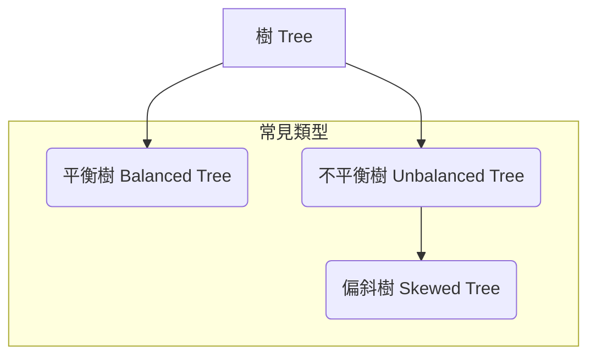

# 樹結構常見測資類型整理

在設計與測試樹相關的演算法時, 涵蓋各種結構特性的測資非常重要. 以下是常見的樹測資類型分類與說明:

---

## 1. 空樹 (Empty Tree)

- 節點數為 0, `root == nullptr`
- 用於測試 base case 是否正確處理

---

## 2. 單一節點 (Single Node)

- 僅有一個根節點, 無子節點
- 測試最小非空結構

---

## 3. 完美二元樹 (Perfect Binary Tree)

- 每個非葉節點都有兩個子節點, 所有葉節點在同一層
- 節點數為 `2^h - 1`
- 適合測試層級遍歷, 空間複雜度上限等

---

## 4. 完全二元樹 (Complete Binary Tree)

- 除最後一層外皆為滿, 最後一層從左至右填滿
- 常見於 heap 結構

---

## 5. 偏斜樹 (Skewed Tree / Degenerate Tree)

- **定義**: 每個節點最多只有一個子節點, 整棵樹退化成一個鏈表結構
- **類型**:
  - **左偏樹 (Left-skewed Tree)**: 所有節點都只有左子節點
  - **右偏樹 (Right-skewed Tree)**: 所有節點都只有右子節點
- **用途**: 測試遞迴深度的最壞情況, 以及演算法在極端不平衡結構下的表現

---

## 6. 不平衡樹 (Unbalanced Tree)

- **定義**: 一個廣義的分類, 指左右子樹的高度差異很大的樹. `Skewed Tree` 是其最極端的特例
- **特性**:
  - 結構不對稱, 可能是某些分支特別深
  - 常見於未經平衡處理的二元搜尋樹 (BST) 中, 因插入順序導致
- **用途**: 測試演算法在非理想, 非對稱結構下的穩健性

---

## 7. 隨機結構樹 (Random Tree)

- 節點分佈不規則, 左右子樹深度不一
- 用於模擬真實世界中更常見的, 無特定規律的樹結構

---

## 8. 重複值樹 (Tree with Duplicates)

- 節點值可能重複
- 用於測試演算法是否能正確處理相同值的節點, 特別是在二元搜尋樹 (BST) 的相關操作中

---

## 總結: 樹的類型關係

- **不平衡樹**是一個廣泛的概念
- **偏斜樹 (Skewed Tree)** 是不平衡樹中最極端的一種情況, 其結構類似鏈表

這些測資類型可作為設計單元測試與面試題驗證的基礎, 確保演算法在各種結構下皆能正確運作
