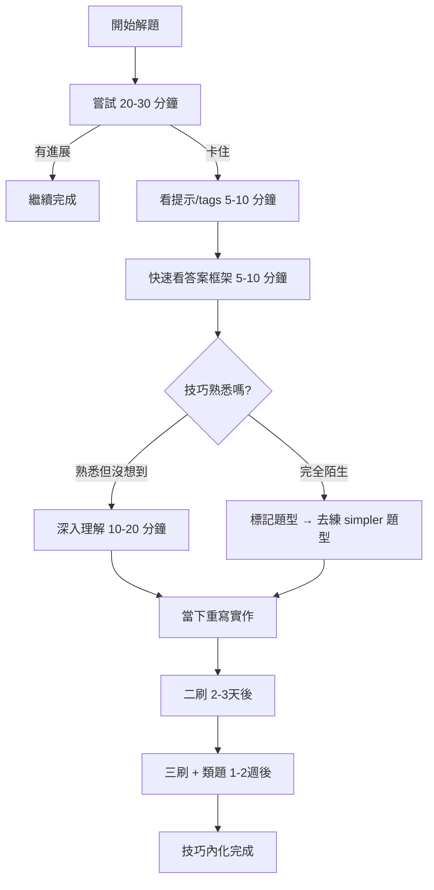

# Hard Problem Learning Strategy

解決 LeetCode Hard 題的系統化學習流程，避免無效卡關，最大化學習效率。

## TL;DR

- ⏱️ **20-30 分鐘**自己嘗試，確保有推導過程
- 🔍 **看 hint/tags** 確認方向
- 📖 **快速看答案框架**，抓核心 insight
- ❓ **技巧陌生？** → 標記題型 + 先練 simpler 題
- 🔄 **二刷/三刷**內化概念

---

## 🔄 Complete Flow Chart

---

## ⏱️ Time Allocation

| Stage              | Time      | Action                                                      | Goal                    |
| ------------------ | --------- | ----------------------------------------------------------- | ----------------------- |
| **1. 自己嘗試**    | 20-30 min | 嘗試暴力/DP/DFS/Greedy，寫出 recurrence，推估複雜度          | 完整思路，不求正解       |
| **2. 看提示**      | 5-10 min  | 看 LeetCode hints/tags，確認演算法範疇                       | 避免方向錯誤             |
| **3. 看答案框架**  | 5-10 min  | 快速抓框架：題型是什麼？核心 insight 是什麼？                | 先標記，不用全懂         |
| **4. 判斷熟悉度**  | 即時      | 熟悉但沒想到 → 深入理解 完全陌生 → 標記題型，練 simpler 題 | 避免在 Hard 題硬背       |
| **5. 當下重寫**    | 10-15 min | 關掉答案，自己實作一次                                       | 建立肌肉記憶             |
| **6. 二刷**        | 2-3 天後  | 再完整解一次，不看答案                                       | 測試是否真正掌握         |
| **7. 三刷 & 類題** | 1-2 週後  | 再寫一次 + 練同類題                                          | 強化題型掌握度           |

---

## ✅ Decision Checklist

### 階段 1: 自己嘗試 (20-30 min)
- [ ] 是否嘗試過至少 2 種不同的方法？
- [ ] 是否寫出了部分的 recurrence 或狀態轉移？
- [ ] 是否推估過時間/空間複雜度？
- [ ] 是否有完整的推導過程（即使錯誤）？

### 階段 2: 看答案前
- [ ] 是否已經看過 hints/tags？
- [ ] 是否確認了演算法的大方向（DP/Graph/Greedy/etc.）？
- [ ] 是否記錄了自己的想法和卡關點？

### 階段 3: 看答案後
- [ ] 這個技巧是否完全陌生（從未練過）？
  - ✅ 是 → 標記題型，去 `Hard_Techniques_Reference.md` 找 simpler 題
  - ❌ 否 → 深入理解 10-20 分鐘
- [ ] 是否理解了核心 insight（不只是記住步驟）？
- [ ] 是否能用自己的話解釋這個解法？

### 階段 4: 重寫與復習
- [ ] 當下是否能不看答案重寫一次？
- [ ] 是否已經加入二刷/三刷計畫？
- [ ] 是否在 `Checklists/Lists/09_Problem_Review.md` 中標記，並記入 `Checklists/Practice_Log.md`？

---

## 🎯 核心原則

### ❌ 避免的陷阱
- **無限卡關**：超過 30 分鐘還沒進展，應該看提示
- **直接看答案**：沒有自己嘗試就看答案，學習效果差
- **死背答案**：看完答案就以為懂了，沒有重寫驗證
- **在 Hard 題硬學新技巧**：應該先練 simpler 題建立基礎

### ✅ 有效的做法
- **時間控制**：20-30 分鐘自己嘗試 → 5-10 分鐘看提示/答案
- **分層學習**：Hard 題識別技巧 → 練 simpler 題 → 回來再解
- **重寫驗證**：看完答案後立刻重寫，確保真的懂
- **系統復習**：二刷、三刷機制確保內化

---

## 📝 實際操作範例

### 情境 1: 技巧熟悉但沒想到
**問題**: LC 312 Burst Balloons (Hard)
**狀況**: 知道是 Interval DP，但沒想到要「最後戳破」的 insight

**行動**:
1. 深入理解 10-20 分鐘，理解「最後戳破」的核心思路
2. 當下重寫實作
3. 加入二刷計畫（2-3 天後）

### 情境 2: 技巧完全陌生
**問題**: LC 315 Count of Smaller Numbers After Self (Hard)
**狀況**: 完全不知道 Merge Sort 可以用來 count inversions

**行動**:
1. 標記題型：Merge Sort Variant
2. 去 `Hard_Techniques_Reference.md` 找對應的 simpler 題
3. 先練習：
   - LC 327 Count of Range Sum (Medium)
   - LC 493 Reverse Pairs (Hard but simpler)
4. 練完後再回來解 LC 315

---

## 🔗 相關資源

- **技巧清單**: [Hard_Techniques_Reference.md](Hard_Techniques_Reference.md)
- **問題追蹤**: [09_Problem_Review.md](../Checklists/Lists/09_Problem_Review.md) · [Practice_Log.md](../Checklists/Practice_Log.md)
- **通用策略**: [Problem_Solving_Strategies.md](Problem_Solving_Strategies.md)

---

## 💡 最終心法

> **Hard 題不是用來「硬解」的，而是用來「識別技巧缺口」的。**
>
> 當你遇到完全陌生的技巧，不用硬看完答案，先標記題型 → 找 simpler 題型練習 → 再回來挑戰。這樣能把 Hard 拆解成「題型學習 + 熟練度累積」兩步走，效率會高很多。
