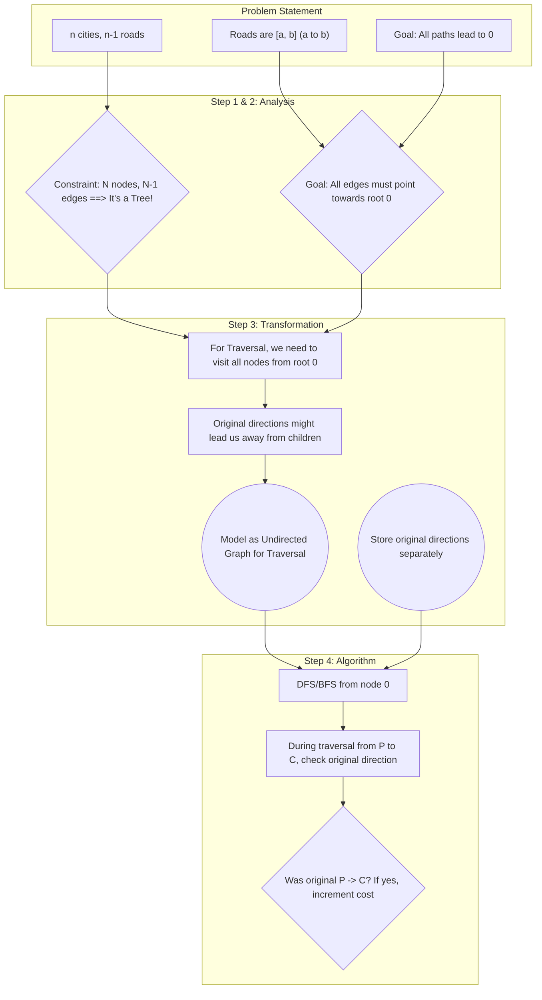

# 4-Step Framework for Problem Transformation (Generated by Gemini 2.5)

This document outlines a generalized framework for transforming a word problem into a formal, solvable model. This skill is crucial for competitive programming and technical interviews.

### The Core Idea: Stripping Away the Story

Most algorithmic problems are classic computer science models (like graphs, trees, arrays) dressed up in a story. Your primary goal is to strip away the story's "chrome" to reveal the underlying mathematical or logical structure.

---

### Step 1: Deconstruct the "Nouns" and "Verbs" (Identify Core Entities & Relationships)

First, break down the problem statement into its fundamental components.

- **Nouns (Entities):** What are the core objects? These often become your nodes, array elements, or data points.
- **Verbs (Relationships & Actions):** What are the actions or relationships connecting the entities? These suggest the type of algorithm or the properties of your data structure.
- **Adjectives (Properties):** What are the attributes of the entities? These become weights, capacities, or other metadata.

**Case Study: LeetCode 1466. Reorder Routes**

- **Nouns:** "cities", "roads" -> **Nodes** and **Edges**.
- **Verbs:** "travel between", "road from `ai` to `bi`" -> **Directed Graph**, goal involves **reachability/traversal**.
- **Adjectives:** "n cities, n-1 roads", "only one way to travel" -> **Tree Structure**.

---

### Step 2: Formalize Constraints and the Goal (Analyze the "Rules of the Game")

Translate the properties and goals into formal, unambiguous terms.

- **Analyze Constraints:**
  - _Statement:_ "n cities and n-1 roads" + "only one way to travel between two different cities".
  - _Formalization:_ A connected graph with `N` nodes and `N-1` edges is, by definition, a **tree**. This is a critical insight that simplifies the problem.
- **Analyze the Goal:**
  - _Statement:_ "reorienting some roads such that each city can visit the city 0."
  - _Formalization:_ A path must exist from every node `i` to node `0`. In a tree, this means all edges must point towards the root (city 0).
- **Analyze the "Cost":**
  - _Statement:_ "Return the minimum number of edges changed."
  - _Formalization:_ Count the number of edges pointing _away_ from the root.

---

### Step 3: Select the Abstract Model (Choose Your Weapon)

Based on the formal problem, select the best data structure and algorithmic paradigm. This is the "transformation" step.

- **The Challenge:** To check edge orientation relative to the root (0), we must first establish the tree's structure (parent-child relationships). The given directions might lead us away from the root during traversal.
- **The Transformation:** To visit the entire tree from the root, we must ignore the given directions _for the purpose of traversal_. We model the connections as an **undirected graph** to ensure we can travel between parent and child, then check the original direction as a separate step.
- **The Model:**
  1.  An **Adjacency List** to represent the tree's structure (undirected).
  2.  A `std::set` or `std::unordered_set` of pairs to store the original directed edges for efficient lookup.
  3.  A **Graph Traversal Algorithm (DFS or BFS)** starting from the root (node 0).

---

### Step 4: Map the Algorithm to the Model (Execute the Plan)

Finally, implement the logic based on the chosen model.

1.  **Build Data Structures:**
    - Create the adjacency list for the undirected graph.
    - Populate a set with the original directed edges.
2.  **Run Traversal:**
    - Start DFS/BFS from node `0`.
    - Use a `visited` array to avoid cycles/backtracking.
    - When traversing from `parent` to `neighbor`, check the original direction in the set.
    - If the edge `{parent, neighbor}` exists in the original set, it points away from the root. Increment a counter.
3.  **Return Result:** The counter holds the minimum number of reorientations needed.

### How to Train This Skill

1.  **Conscious Application:** For every problem, consciously walk through these four steps. Write it down before coding.
2.  **Identify the Core Pattern:** After solving, ask: "What was the key transformation?" (e.g., "Treating a directed tree as undirected for traversal," "Modeling a grid as a graph").
3.  **Focus on Constraints:** Pay extra attention to constraints. A small detail can completely change the required model.
4.  **Generalize:** Think about how the same transformation could apply to different problems.

